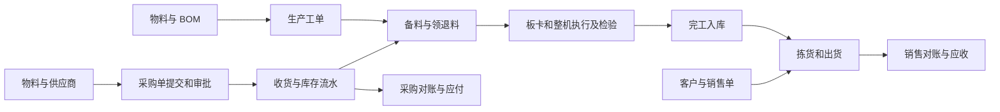

# 显示器制造 ERP 总体设计

版本 1.0，2026-11-09。适用于 `LearningErp.Api/Erp`。这是模拟学习项目的设计基线，后续功能按此逐步实现。ERPNext 用于对照业务单据和流程，继续使用本项目的 C#、ASP.NET Core、EF Core、SQLite 和网页工作台。

| 文档 | 内容 |
| --- | --- |
| [ERP 模块详细设计](12-erp-module-design.md) | 各模块的业务规则、数据、页面、接口与验收 |
| [ERP 开发与验证计划](13-erp-development-plan.md) | 开发依赖、逐步任务、验收顺序和贯通案例 |
| [ERPNext 采购对照设计](10-erpnext-procurement-reference.md) | 采购单、收货单、库存流水在 ERPNext 中的对应实现 |
| [MES 与 SMT 衔接设计](07-smt-requirements.md) | 板卡、料卷、上料防错及整机追溯需求 |

## 1. 范围与现状

目标是模拟显示器工厂从主数据、采购、收货、生产到销售出货的完整业务，并在业务闭环稳定后加入模拟财务。ERP 管理主数据、业务单据、计划和对账；库存模块处理数量及实物流转；MES 负责工位执行、品质与单件追溯。仓库作业和 MES 先在同一应用内以模块衔接，后续独立应用仍沿用相同业务边界。

当前代码已有物料维护及状态筛选、供应商查询和新增、采购草稿创建及按 ID 查询、SQLite 迁移和浏览器工作台。采购列表 DTO 已创建，服务查询和列表路由仍待完成。审批、收货、库存、生产、销售、财务和权限均为规划。早期内存示例目录 `src/` 用作历史参考，学习主线以 `LearningErp.Api/Erp` 为准。

第一版假设一个工厂、单一币种 CNY、整数基础单位、不超收、不允许负库存。单价与金额使用 `decimal`，统一以每行金额四舍五入到两位小数后求和；币种和单位换算独立扩展。财务部分用于演示应收应付和过账规则，不覆盖法定财务、税务申报与工资。高级 MRP、设备联锁和自动化仓储在核心流程之后评估。

## 2. 核心业务链

采购单和销售单记录业务承诺；收货、发货和完工单记录实物变动；发票与收付款记录模拟应收应付。每个下游单据保留来源行 ID，以支持分批交付、按行校验和反向追溯。此划分参考 [ERPNext 采购单](https://docs.frappe.io/erpnext/purchase-order)、[收货单](https://docs.frappe.io/erpnext/purchase-receipt)、[销售订单](https://docs.frappe.io/erpnext/sales-order) 和 [收付款说明](https://docs.frappe.io/erpnext/payment-entry)。

## 3. 技术与数据约定

| 层次 | 职责与约定 |
| --- | --- |
| 网页 | HTML/CSS/JavaScript 同源调用 API。业务模块提供列表、详情和操作入口。操作提交期间防止重复点击，失败后展示后端业务消息 |
| HTTP | Controller 绑定 DTO、执行授权和返回结果。路径用复数资源名；单据动作使用 `POST /api/{resource}/{id}/{action}`。新接口返回 201/200/204，校验失败 400，无权 403，不存在 404，业务冲突 409 |
| 应用服务 | 校验状态、执行规则并协调事务。使用已有 `ErpDbContext`；服务与上下文按请求创建。不同模块通过明确的业务操作协作 |
| 数据库 | 单据用内部 ID 关联，业务单号另设唯一约束；主数据保持当前编码主键。数据库约束保护唯一性和外键。字段变更用新迁移，保留已应用的历史 |
| 日志与审计 | 技术日志记异常和关联请求 ID；业务审计记录操作者、单据、动作、前后状态、时间。关键过账与审计同事务 |

### 通用单据规则

- 有审批的单据采用草稿、待审批、已批准、驳回或关闭等显式动作。每种单据在详细设计中定义允许的转换，服务层校验，页面按钮反映状态。采购审批状态和收货进度分别展示。
- 已发生下游交易的单据保留历史。关闭用于结束剩余业务；退货或冲销产生关联反向记录。禁止通过改旧流水纠正库存。
- 已引用的物料、供应商、客户和仓库采用停用。服务校验新单可用性，历史读取继续允许。
- 库存余额按仓库和物料汇总；后续按库位、批次和库存状态扩展。所有库存写入通过统一过账服务。流水记录来源、变动量、时间与操作者，余额可以按流水对账。
- 库存过账使用请求键和来源行约束防重。超收和库存不足校验与写入处于同一事务，并通过数据库并发控制防止两条请求同时占用剩余数量。冲突回滚整个业务动作。
- 服务器保存 UTC 时间，界面按本地时间显示。数据库备份和迁移先在复制的数据库上演练，验证完整后再应用到学习数据。

## 4. 如何对照 ERPNext

每个模块先看官方操作手册，找出输入、输出和上下游单据；再读源码里的字段定义、校验方法和测试；最后将关键行为写成本项目的规则和验收用例。ERPNext 的 Frappe 单据控制器管理文档生命周期，本项目由 C# Service 处理同类业务规则，ASP.NET Core Controller 处理 HTTP。 [Frappe 生命周期](https://docs.frappe.io/framework/user/en/basics/doctypes/controllers)

模块文档中的接口与实体属于本项目设计。若未来增加新条件，先修改业务规则及验收，再调整表、API 和页面。
